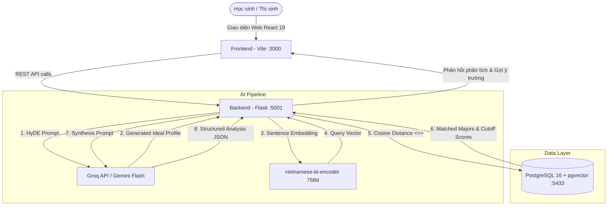

# 🎓 AI University Adviser — Hệ Thống Tư Vấn Hướng Nghiệp Đại Học Thông Minh

<div align="center">

[](https://python.org)
[](https://flask.palletsprojects.com)
[](https://react.dev)
[](https://vite.dev)
[](https://tailwindcss.com)
[](https://github.com/pgvector/pgvector)
[](https://www.docker.com)

**Hệ thống AI tư vấn hướng nghiệp và gợi ý trường đại học thông minh** dựa trên phân tích ngôn ngữ tự nhiên từ học sinh, ứng dụng mô hình **RAG (Retrieval-Augmented Generation)**, **pgvector semantic search** và dữ liệu điểm chuẩn thi tốt nghiệp THPT Quốc gia.

[Tính năng](#-tính-năng-chính) · [Kiến trúc](#-kiến-trúc-hệ-thống) · [Khởi động nhanh](#-khởi-động-nhanh-với-docker) · [API Reference](#-tài-liệu-api-endpoints) · [Cấu trúc](#-cấu-trúc-thư-mục)

</div>

---

## 🌟 Tính Năng Chính

1. **🧠 Phân tích Tính cách & Định hướng Nghề nghiệp (AI Personality Analysis)**:
   - Học sinh nhập tự do tâm tư, sở thích, thế mạnh hoặc ước mơ nghề nghiệp.
   - Áp dụng kỹ thuật **HyDE (Hypothetical Document Embeddings)** trích xuất chân dung nghề nghiệp lý tưởng bằng LLM (Groq / Gemini).
   - Mã hóa ngữ nghĩa tiếng Việt sang vector 768 chiều với `bkai-foundation-models/vietnamese-bi-encoder`.
   - Truy vấn tìm kiếm độ tương đồng cosine thông qua **PostgreSQL pgvector** để match các ngành học đại học chính xác nhất.
2. **📝 Xác định Tổ hợp môn & Tính Điểm Xét tuyển**:
   - Tự động nhận diện các khối thi hợp lệ (A00, A01, B00, D01, D07...) dựa trên các môn thi tốt nghiệp THPT thí sinh đã có điểm.
   - Tính tổng điểm theo từng tổ hợp xét tuyển.
3. **🏫 Gợi ý Trường Đại học Theo Điểm thi & Khu vực**:
   - Đối sánh điểm xét tuyển với cơ sở dữ liệu điểm chuẩn các năm gần nhất.
   - Phân loại nguyện vọng theo mức độ: **An toàn (Safe)**, **Vừa sức (Fit)** và **Thử thách (Reach)**.
   - Hỗ trợ lọc trường theo vùng miền: Bắc, Trung, Nam hoặc Toàn quốc.
4. **🐳 Triển khai Toàn diện bằng Docker**:
   - Toàn bộ Database (pgvector), Backend (Flask) và Frontend (React Vite) được đóng gói và vận hành qua Docker Compose chỉ với một lệnh.

---

## 🏗️ Kiến Trúc Hệ Thống



---

## 🚀 Khởi Động Nhanh Với Docker

### 1. Yêu cầu Tiên quyết
- Đã cài đặt **Docker** và **Docker Compose**.
- API Key của **Groq** (hoặc Google Gemini).

### 2. Chuẩn bị file `.env`
Tạo file `.env` tại thư mục gốc của dự án:
```env
# Database Settings
DB_USER=adviser
DB_PASS=adviser_pass
DB_HOST=db
DB_PORT=5432
DB_NAME=ai_uni_adviser

# AI LLM Keys
GROQ_API_KEY=gsk_your_groq_api_key_here
GEMINI_API_KEY=your_gemini_api_key_here

# Optional: Redis Cache & Origins
REDIS_URL=
ALLOWED_ORIGINS=http://localhost:3000,http://127.0.0.1:3000,http://localhost:5173
```

### 3. Khởi chạy toàn bộ hệ thống
```bash
# macOS: dùng socket unix nếu cần
DOCKER_HOST=unix:///var/run/docker.sock docker compose up -d --build
```

### 4. Khởi tạo Cơ sở dữ liệu & Nạp Dữ liệu Mẫu (Seed Data)
Chạy script seed bên trong container backend để tự động tạo schema bảng, cài đặt extension pgvector và nạp dữ liệu trường, ngành, điểm chuẩn mẫu:
```bash
DOCKER_HOST=unix:///var/run/docker.sock docker compose exec backend python seed.py
```

### 5. Truy cập Ứng dụng
- **Giao diện Web (Frontend)**: [http://localhost:3000](http://localhost:3000)
- **API Backend**: [http://localhost:5001](http://localhost:5001)
- **PostgreSQL Database**: `localhost:5433` (User: `adviser`, DB: `ai_uni_adviser`)

---

## 💻 Chạy Trực Tiếp Không Qua Docker (Local Development)

Nếu muốn phát triển hoặc debug mã nguồn trực tiếp trên máy host:

### Backend
```bash
# Tạo môi trường ảo
python3 -m venv venv
source venv/bin/activate

# Cài đặt thư viện
pip install -r requirements.txt

# Chạy Flask backend (port 5001)
export FLASK_APP=app.py
export FLASK_RUN_PORT=5001
flask run
```

### Frontend
```bash
cd frontend

# Cài đặt dependencies
npm install

# Khởi chạy Vite Dev Server
npm run dev
```

---

## 📡 Tài Liệu API Endpoints

### 1. Kiểm tra trạng thái hệ thống
- **Endpoint**: `GET /api/test`
- **Response**:
```json
{
  "status": "success",
  "message": "AI University Adviser API is working!"
}
```

### 2. Xác định khối thi hợp lệ
- **Endpoint**: `POST /api/get-valid-groups`
- **Request Body**:
```json
{
  "scores": {
    "math": 8.5,
    "physics": 8.0,
    "chemistry": 7.5
  }
}
```
- **Response**: Trả về danh sách tổ hợp hợp lệ kèm tổng điểm thi (VD: `A00` = 24.0).

### 3. Tìm kiếm và Gợi ý Trường Đại học
- **Endpoint**: `POST /api/find-universities`
- **Request Body**:
```json
{
  "major_ids": [1, 2],
  "region": "MIEN_BAC",
  "group_scores": {
    "A00": 24.0
  }
}
```
- **Response**: Danh sách các trường đại học đào tạo ngành đó kèm điểm chuẩn và phân loại cơ hội trúng tuyển.

### 4. Phân tích Tính cách & Hướng nghiệp RAG
- **Endpoint**: `POST /api/analyze-personality`
- **Request Body**:
```json
{
  "personality_text": "Em đam mê viết code, tìm tòi công nghệ mới, thích môn Toán và muốn chế tạo robot hoặc phần mềm thông minh."
}
```
- **Response**:
```json
{
  "tags": ["Logic", "Công nghệ thông tin", "Kỹ thuật", "Tư duy sáng tạo"],
  "summary": "Thí sinh có thiên hướng tư duy logic sắc bén, kỹ năng toán học tốt và đam mê sáng tạo công nghệ...",
  "detailed_analysis": "### 1. Nhóm ngành Công nghệ thông tin (Mã ngành: 7480201)..."
}
```

---

## 📁 Cấu Trúc Thư Mục

```text
ai_uni_adviser/
├── .agents/                 # Cấu hình AI Assistant (Rules & Skills)
│   ├── rules/
│   │   └── project-rules.md # Quy chuẩn kiến trúc, quy định cổng và pgvector
│   └── skills/
│       ├── db-manager/      # Kỹ năng thao tác CSDL, seed data & pgvector
│       ├── docker-runner/   # Kỹ năng vận hành lifecycle Docker container
│       ├── git-formatter/   # Chuẩn commit theo Conventional Commits
│       ├── rag-pipeline/    # Kỹ năng debug luồng RAG HyDE & Bi-Encoder
│       └── unit-tester/     # Kỹ năng tạo Unit Test
├── frontend/                # Ứng dụng React 19 + Vite 8
│   ├── src/                 # Components, hooks, styles
│   ├── Dockerfile           # Docker container cho frontend
│   ├── package.json
│   └── vite.config.js       # Proxy cấu hình sang backend port 5001
├── routes/                  # Flask Blueprints
│   ├── analyze.py           # Endpoint RAG phân tích tính cách
│   ├── universities.py      # Endpoint tra cứu trường & điểm chuẩn
│   ├── subjects.py          # Endpoint tính điểm và khối thi
│   └── test.py              # Health check endpoint
├── services/                # Dịch vụ tầng phụ trợ (Cache, logic ngoài)
│   └── cache_service.py     # Caching fallback an toàn
├── app.py                   # Khởi tạo Flask Application & middleware
├── config.py                # Cấu hình môi trường & Model AI
├── extensions.py            # Khởi tạo SQLAlchemy, Limiter, Redis
├── models.py                # Định nghĩa CSDL SQLAlchemy
├── seed.py                  # Khởi tạo bảng, vector pgvector & seed mẫu
├── Dockerfile               # Dockerfile backend Flask
├── docker-compose.yml       # Điều phối PostgreSQL (pgvector), Backend, Frontend
└── requirements.txt         # Danh sách thư viện Python
```

---

## 🛠️ Xử Lý Lỗi Thường Gặp (Troubleshooting)

| Vấn đề | Nguyên nhân | Cách khắc phục |
|---|---|---|
| **Port 5000 already in use** | macOS sử dụng port 5000 cho tính năng AirPlay Receiver | Dự án đã map sang port **`5001`** trên host (`5001:5000`). Truy cập backend tại `http://localhost:5001`. |
| **Timeout lần đầu gọi `/api/analyze-personality`** | Backend tự động tải model `vietnamese-bi-encoder` (~500MB) về máy | Chờ 2–4 phút để tải xong. Model được lưu vào volume `hf_cache` nên các lần khởi động sau sẽ tức thì. |
| **Model groq not exist** | Model Groq chỉ định không tồn tại trên tài khoản | Dự án mặc định sử dụng `qwen/qwen3.8-27b` hoặc `llama-3.3-70b-versatile`. |
| **Database connection refused** | Container DB chưa kịp healthy khi backend start | Docker Compose đã cài sẵn healthcheck cho service `db` để đảm bảo backend chỉ chạy khi DB đã sẵn sàng. |

---

<div align="center">
Made with ❤️ for Vietnamese High School Students
</div>