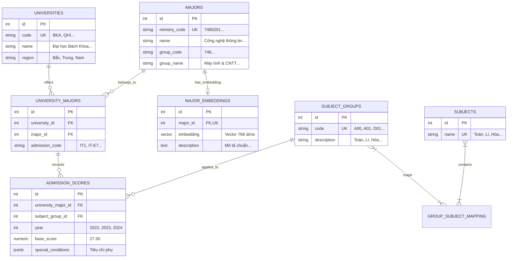

# Báo Cáo Đóng Góp — Thành Viên A
### Dự án: AI University Adviser

> **Thành viên:** Bùi Tuệ Mẫn  
> **Vai trò:** Backend Core · Database Architecture & Modeling · REST API Data Routes · Data Collection & Embedding Pipeline

---

## Mục lục

1. [Phân tích hệ thống và phân chia công việc](#1-phân-tích-hệ-thống-và-phân-chia-công-việc)
   - 1.1 [Cách tiếp cận phân tích](#11-cách-tiếp-cận-phân-tích)
   - 1.2 [Kiến trúc tổng thể sau phân tích](#12-kiến-trúc-tổng-thể-sau-phân-tích)
   - 1.3 [Phân chia công việc giữa 3 thành viên](#13-phân-chia-công-việc-giữa-3-thành-viên)
   - 1.4 [Điểm giao nhau giữa Thành viên A với các thành viên khác](#14-điểm-giao-nhau-giữa-thành-viên-a-với-các-thành-viên-khác)
2. [Cấu trúc thư mục — phần của Thành viên A](#2-cấu-trúc-thư-mục--phần-của-thành-viên-a)
   - 2.1 [Sơ đồ vị trí các file phụ trách](#21-sơ-đồ-vị-trí-các-file-phụ-trách)
   - 2.2 [Mô tả chi tiết và giải pháp kỹ thuật từng file](#22-mô-tả-chi-tiết-và-giải-pháp-kỹ-thuật-từng-file)
     - 2.2.1 [Hạ tầng khởi tạo: app.py, config.py, extensions.py, requirements.txt, .env.example](#221-hạ-tầng-khởi-tạo-apppy-configpy-extensionspy-requirementstxt-envexample)
     - 2.2.2 [Cơ sở dữ liệu & ORM Models: models.py (6 bảng & quan hệ)](#222-cơ-sở-dữ-liệu--orm-models-modelspy-6-bảng--quan-hệ)
     - 2.2.3 [Route xử lý khối thi: routes/groups.py](#223-route-xử-lý-khối-thi-routesgroupspy)
     - 2.2.4 [Route tra cứu & lọc trường: routes/universities.py](#224-route-tra-cứu--lọc-trường-routesuniversitiespy)
     - 2.2.5 [Thu thập & chuẩn hóa dữ liệu: database/seed.sql](#225-thu-thập--chuẩn-hóa-dữ-liệu-databaseseedsql)
     - 2.2.6 [Pipeline nạp Vector ngữ nghĩa: scripts/generate_embeddings.py](#226-pipeline-nạp-vector-ngữ-nghĩa-scriptsgenerate_embeddingspy)
3. [Cách viết code](#3-cách-viết-code)
   - 3.1 [Quy trình phát triển Core Backend & CSDL](#31-quy-trình-phát-triển-core-backend--csdl)
   - 3.2 [Nguyên tắc Clean Code và Best Practices cho Database & Backend](#32-nguyên-tắc-clean-code-và-best-practices-cho-database--backend)
   - 3.3 [Quy tắc commit và quản lý phiên bản](#33-quy-tắc-commit-và-quản-lý-phiên-bản)
4. [Công cụ hỗ trợ phát triển](#4-công-cụ-hỗ-trợ-phát-triển)
   - 4.1 [Lập trình và Quản lý môi trường Python](#41-lập-trình-và-quản-lý-môi-trường-python)
   - 4.2 [Quản trị CSDL PostgreSQL & pgvector Extension](#42-quản-trị-csdl-postgresql--pgvector-extension)
   - 4.3 [Công cụ thiết kế Schema, ERD và Data Modeling](#43-công-cụ-thiết-kế-schema-erd-và-data-modeling)
   - 4.4 [Kiểm thử API và Debug SQL Queries](#44-kiểm-thử-api-và-debug-sql-queries)
   - 4.5 [Phân tích, Thiết kế và Diagram](#45-phân-tích-thiết-kế-và-diagram)
   - 4.6 [AI trợ lý lập trình](#46-ai-trợ-lý-lập-trình)
   - 4.7 [Thu thập & Tiền xử lý dữ liệu Tuyển sinh](#47-thu-thập--tiền-xử-lý-dữ-liệu-tuyển-sinh)

---

## 1. Phân tích hệ thống và phân chia công việc

### 1.1 Cách tiếp cận phân tích

Để xây dựng một nền tảng tư vấn tuyển sinh đại học vững chắc, chịu tải tốt, hỗ trợ cả nghiệp vụ dữ liệu truyền thống (điểm chuẩn, tổ hợp môn, trường học) và cơ chế tìm kiếm ngữ nghĩa nâng cao (Vector Search với `pgvector`), các phương pháp và công cụ sau đã được **Thành viên A** áp dụng:

| Phương pháp | Mục đích | Công cụ |
|---|---|---|
| **Phân tích Quy chế Tuyển sinh Bộ GD&ĐT** | Chuẩn hóa danh mục mã ngành 7 chữ số, mã khối thi, quy tắc tính điểm tổ hợp | Cổng thông tin Bộ GD&ĐT, Đề án tuyển sinh các trường |
| **Thiết kế ERD & Chuẩn hóa dữ liệu 3NF** | Xây dựng mô hình dữ liệu quan hệ tối ưu, tránh dư thừa, đảm bảo toàn vẹn tham chiếu | DBeaver, dbdocs.io, PostgreSQL |
| **Nghiên cứu pgvector & Toán tử Cosine** | Tích hợp kiểu dữ liệu `vector(768)` ngay trong PostgreSQL để phục vụ pipeline AI của Thành viên B | PostgreSQL 16, pgvector extension |
| **Kiểm thử hiệu năng truy vấn (Query Profiling)** | Khắc phục vấn đề $N+1$ query khi duyệt tổ hợp môn và tối ưu phép join đa bảng điểm chuẩn | `EXPLAIN ANALYZE`, SQLAlchemy Logging |
| **Thiết kế API Contract độc lập** | Định nghĩa cấu trúc JSON đầu vào/đầu ra rõ ràng để Frontend (Thành viên C) và AI (Thành viên B) tích hợp song song | Postman, Swagger/OpenAPI spec |

---

### 1.2 Kiến trúc tổng thể sau phân tích

Toàn bộ hệ thống được phân lớp rõ ràng. Trong đó, **Thành viên A** đảm nhiệm vai trò **"Xương sống & Nền tảng" (Core Foundation & Data Layer)**:

```
+--------------------------------------------------------------------------+
|                        Frontend (React + Vite)                           | <- Thành viên C
|         PersonalitySection · SubjectSection · ResultPanel                |
|         Giao diện nhập điểm thi, chọn môn -> Gọi REST API -> Hiển thị    |
+--------------------+--------------------------------+--------------------+
                     |                                |
                     | 1. POST /api/get-valid-groups  | 2. POST /api/find-universities
                     v                                v
+--------------------------------------------------------------------------+
|                     FLASK BACKEND CORE (Thành viên A)                    |
|                                                                          |
|  [app.py] Application Factory, CORS Regex, Lifecycle                     |
|  [config.py] Centralized Config (.env, DB_URI, Rate Limits)              |
|  [extensions.py] Decoupled Extensions (db, limiter, init_redis)          |
|                                                                          |
|  [routes/groups.py] POST /api/get-valid-groups                           |
|    - Logic: O(1) Set Lookup & Subset Matching                            |
|    - SQLAlchemy joinedload() triệt tiêu N+1 queries                      |
|                                                                          |
|  [routes/universities.py] POST /api/find-universities                     |
|    - Multi-table JOIN (5 bảng: uni, major, score, group...)              |
|    - Lọc linh hoạt theo Region + Chênh lệch điểm chuẩn (score buffer)    |
+--------------------+--------------------------------+--------------------+
                     |                                ^
                     | SQL Queries / ORM              | AI Majors List
                     v                                |
+-----------------------------------------------------+--------------------+
|                AI PIPELINE & RAG (Thành viên B)                          |
|  [routes/analyze.py] POST /api/analyze-personality                       |
|  [services/ai_service.py] HyDE Groq + Bi-Encoder + Gemini Synthesis      |
+-----------------------------------------------------+--------------------+
                                                      |
                                                      v
+--------------------------------------------------------------------------+
|         POSTGRESQL DATABASE & SEED DATA (Thành viên A)                   |
|                                                                          |
|  [models.py] 6 Bảng chính + Bảng liên kết trung gian:                    |
|    - universities (id, code, name, region...)                            |
|    - majors (id, ministry_code 7 số, name, group_code...)                |
|    - university_majors (id, university_id, major_id, admission_code...)   |
|    - subjects (id, name: Toán, Lí, Hóa, Văn, Anh...)                    |
|    - subject_groups (id, code: A00, D01, description...)                 |
|    - group_subject_mapping (group_id, subject_id)                        |
|    - admission_scores (id, university_major_id, score, year, JSONB...)   |
|    - major_embeddings (id, major_id, vector(768), description...)        |
|                                                                          |
|  [database/seed.sql] Dữ liệu thực tế 20+ trường, mã 7 số, 3 năm điểm     |
|  [scripts/generate_embeddings.py] Batch vectorization 768 dims           |
+--------------------------------------------------------------------------+
```

---

### 1.3 Phân chia công việc giữa 3 thành viên

Dự án được phân chia thành 3 mảng chuyên môn cân bằng về khối lượng và trách nhiệm:

#### Thành viên A (Bùi Tuệ Mẫn) — Backend Core, Database & Data Routes *(Nội dung báo cáo này)*
- **Hạ tầng Flask & Cấu hình:** Thiết kế `app.py`, `config.py`, `extensions.py`, `requirements.txt`, `.env.example`.
- **Mô hình hóa dữ liệu (ORM):** Xây dựng `models.py` với 6 thực thể quan hệ chuẩn hóa và bảng vector phục vụ AI.
- **REST API Nghiệp vụ Tuyển sinh:** Hiện thực `routes/groups.py` (tính tổ hợp môn hợp lệ) và `routes/universities.py` (truy vấn lọc trường theo điểm thi, khu vực).
- **Thu thập dữ liệu Tuyển sinh:** Biên tập `database/seed.sql` với hơn 300 dòng lệnh SQL chuẩn hóa, trích xuất mã ngành chuẩn 7 chữ số từ Bộ GD&ĐT và điểm chuẩn 2022-2024.
- **Data Vectorization Pipeline:** Xây dựng script `scripts/generate_embeddings.py` chạy offline nạp vector 768 chiều cho toàn bộ mô tả ngành học.

#### Thành viên B (Tô Minh Hiến) — AI Pipeline & RAG
- **AI Core Service:** Hiện thực trích xuất ý định (HyDE) qua Groq, mã hóa biểu diễn ngữ nghĩa với `vietnamese-bi-encoder`, tổng hợp lời khuyên qua Gemini 2.5 Flash.
- **Cache & Performance:** Xây dựng lớp đệm Redis với SHA-256 keying và graceful degradation.
- **AI Controller:** `routes/analyze.py` với câu truy vấn pgvector Cosine Distance (`<=>`) mở rộng ngành liên quan.

#### Thành viên C (Bùi Thị Huyền) — Frontend UI/UX
- **Giao diện người dùng:** Xây dựng giao diện React 19 + Vite, thiết kế hệ thống style Tailwind CSS v4, dark theme và hiệu ứng glassmorphism.
- **State Management & Custom Hooks:** `usePersonalityAnalysis`, `useSubjectGroups`, `useUniversitySearch`.
- **Trực quan hóa kết quả:** Hiển thị radar/tag tính cách, danh sách ngành học và thẻ thông tin trường đại học kèm điểm chuẩn.

---

### 1.4 Điểm giao nhau giữa Thành viên A với các thành viên khác

Để dự án vận hành trơn tru và không xảy ra xung đột khi làm việc song song, **Thành viên A** đã thiết lập các **Hợp đồng Dữ liệu (Data Contracts)** và **Hợp đồng API (API Contracts)** chặt chẽ:

```
                  +----------------------------------------+
                  |         Thành viên A (Backend & DB)    |
                  +-------------------+--------------------+
                                      |
         +----------------------------+----------------------------+
         | (Schema & Vector Contract)                              | (REST API Contract)
         v                                                         v
+-------------------------------+                         +-------------------------------+
|    Thành viên B (AI & RAG)    |                         |    Thành viên C (Frontend)    |
| Bảng majors & major_embeddings|                         | 1. POST /api/get-valid-groups |
| Vector 768 dims, pgvector <=> |                         | 2. POST /api/find-universities|
+-------------------------------+                         +-------------------------------+
```

#### 1. Giao tiếp với Thành viên B (AI Pipeline):
- **Cấu trúc bảng Vector:** Thành viên A kiến tạo bảng `major_embeddings` gắn khóa ngoại `major_id` tới `majors`, chứa cột kiểu `vector(768)` và cột `description` ngữ nghĩa học thuật:
  ```sql
  CREATE TABLE major_embeddings (
      id SERIAL PRIMARY KEY,
      major_id INTEGER UNIQUE REFERENCES majors(id) ON DELETE CASCADE,
      embedding vector(768) NOT NULL,
      description TEXT NOT NULL
  );
  ```
- **Script nạp vector (`generate_embeddings.py`):** Thành viên A viết script nạp dữ liệu một lần bằng mô hình `bkai-foundation-models/vietnamese-bi-encoder`. Khi Thành viên B triển khai RAG, CSDL đã sẵn sàng toàn bộ vector chuẩn để thực hiện truy vấn khoảng cách Cosine `<=>`.
- **Shared Extensions:** Chia sẻ `extensions.py` (`db`, `limiter`, `redis_client`) và `config.py` để Thành viên B dễ dàng bổ sung các tham số AI (`GROQ_API_KEY`, `GEMINI_API_KEY`).

#### 2. Giao tiếp với Thành viên C (Frontend):
Thành viên A chịu trách nhiệm cung cấp 2 REST API endpoints cốt lõi cho quy trình chọn khối và tra cứu trường:

- **Endpoint 1: `POST /api/get-valid-groups`**
  - **Request Body:**
    ```json
    { "subject_ids": [1, 2, 4] }
    ```
  - **Response Body (200 OK):**
    ```json
    {
      "status": "success",
      "valid_groups": [
        {
          "id": 1,
          "code": "A00",
          "description": "Toán, Vật lí, Hóa học",
          "subject_ids": [1, 2, 3]
        },
        {
          "id": 2,
          "code": "A01",
          "description": "Toán, Vật lí, Tiếng Anh",
          "subject_ids": [1, 2, 4]
        }
      ]
    }
    ```
  - *Đặc tả quan trọng:* Thành viên A trả về mảng `subject_ids` nguyên bản dạng `int`. Điều này giúp Thành viên C tính điểm trung bình/tổng điểm chính xác trên client mà không cần parse chuỗi văn bản `description`.

- **Endpoint 2: `POST /api/find-universities`**
  - **Request Body:**
    ```json
    {
      "ai_majors": ["Công nghệ thông tin", "Kỹ thuật phần mềm"],
      "region": "Bắc",
      "user_groups": [
        { "group_code": "A00", "user_score": 26.5 },
        { "group_code": "A01", "user_score": 25.8 }
      ]
    }
    ```
  - **Response Body (200 OK):**
    ```json
    {
      "status": "success",
      "total_results": 12,
      "data": [
        {
          "university_code": "BKA",
          "university_name": "Đại học Bách khoa Hà Nội",
          "region": "Bắc",
          "major_name": "Công nghệ thông tin",
          "admission_code": "IT1",
          "group_code": "A00",
          "admission_scores": [
            { "year": 2024, "base_score": 27.2, "status": "cạnh tranh" },
            { "year": 2023, "base_score": 26.8, "status": "cạnh tranh" },
            { "year": 2022, "base_score": 26.5, "status": "an toàn" }
          ]
        }
      ]
    }
    ```

---

## 2. Cấu trúc thư mục — phần của Thành viên A

### 2.1 Sơ đồ vị trí các file phụ trách

Toàn bộ các tệp do **Thành viên A** trực tiếp xây dựng, quản lý và chịu trách nhiệm chính được đánh dấu `[A]`:

```
ai_university_adviser/
|
+-- app.py                       [A] Flask Application Factory, CORS config, lifecycle (~34 dòng)
+-- config.py                    [A] Centralized configuration, kết nối CSDL, rate limit (~35 dòng)
+-- extensions.py                [A] Khởi tạo SQLAlchemy, Limiter, kết nối Redis (~30 dòng)
+-- models.py                    [A] 6 Bảng ORM + bảng quan hệ N-N chuẩn hóa (~64-80 dòng)
+-- requirements.txt             [A] Quản lý dependencies môi trường (~49 dòng)
+-- .env.example                 [A] Mẫu biến môi trường bảo mật (~15 dòng)
|
+-- routes/
|   +-- __init__.py              [A] Đăng ký dynamic blueprints
|   +-- groups.py                [A] POST /api/get-valid-groups (subset check, joinedload) (~37 dòng)
|   +-- universities.py          [A] POST /api/find-universities (SQL join, filter region + score) (~80 dòng)
|   +-- analyze.py               [B] AI RAG Controller
|
+-- database/
|   +-- schema.sql               [A] DDL tạo bảng, ràng buộc toàn vẹn, kích hoạt pgvector
|   +-- seed.sql                 [A] Dữ liệu thu thập: mã 7 số Bộ GD&ĐT, trường, điểm chuẩn (~300+ dòng SQL)
|
+-- scripts/
|   +-- generate_embeddings.py   [A] Nạp vector 768 chiều từ vietnamese-bi-encoder (~60 dòng)
|
+-- services/                    [B] AI Services & Cache
+-- frontend/                    [C] React 19 Frontend
+-- docs/
    +-- readme/
        +-- README_BuiTueMan.md  [A] Báo cáo kỹ thuật chi tiết của Thành viên A (file này)
        +-- README_ToMinhHien.md [B] Báo cáo kỹ thuật Thành viên B
        +-- README_BuiThiHuyen.md[C] Báo cáo kỹ thuật Thành viên C
```

---

### 2.2 Mô tả chi tiết và giải pháp kỹ thuật từng file

---

#### 2.2.1 Hạ tầng khởi tạo: `app.py`, `config.py`, `extensions.py`, `requirements.txt`, `.env.example`

Khối hạ tầng này thiết lập môi trường chạy ứng dụng Flask chuẩn mực công nghiệp, đảm bảo tính mô-đun hóa, bảo mật và khả năng mở rộng.

##### 1. `app.py` — Flask Application Factory & Server Entry Point (~34 dòng)
- **Vấn đề giải quyết:** Khi xây dựng ứng dụng với nhiều blueprint và cơ sở dữ liệu, việc import chéo (circular import) rất dễ xảy ra nếu tạo thực thể app toàn cục bừa bãi. Ngoài ra, việc giao tiếp với Vite frontend trên môi trường dev thường xuyên gặp lỗi CORS do thay đổi port động.
- **Giải pháp kỹ thuật:**
  - Áp dụng pattern khởi tạo rõ ràng, tách biệt khởi tạo instance và cấu hình extensions.
  - Cấu hình Unicode tiếng Việt thông suốt: `app.json.ensure_ascii = False`, đảm bảo mọi phản hồi JSON chứa tiếng Việt có dấu không bị biến thành ký tự thoát `\uXXXX`.
  - Cơ chế **CORS Regex thông minh**: Cho phép tự động nhận diện mọi port dev của frontend:
    ```python
    _cors_origins = Config.ALLOWED_ORIGINS
    if not _cors_origins or _cors_origins == ['http://localhost:5173', 'http://127.0.0.1:5173']:
        _cors_origins = _re.compile(r"http://(localhost|127\.0\.0\.1):\d+")
    CORS(app, origins=_cors_origins)
    ```
  - Kết nối tập trung các extension: `limiter.init_app(app)`, `db.init_app(app)`, `init_redis(Config.REDIS_URL)`, và `register_blueprints(app)`.

##### 2. `config.py` & `.env.example` — Cấu hình tập trung & Bảo mật (~50 dòng)
- **Vấn đề giải quyết:** Tránh tình trạng "hardcode" thông tin nhạy cảm (mật khẩu CSDL, API keys) trong mã nguồn. Cần một điểm điều khiển duy nhất cho toàn bộ hệ thống từ timeout, connection string đến rate limiting.
- **Giải pháp kỹ thuật:**
  - Tải tự động biến môi trường thông qua `python-dotenv`.
  - Sinh chuỗi kết nối chuẩn `DB_URI` kết hợp `DB_USER`, `DB_PASS`, `DB_HOST`, `DB_PORT`, `DB_NAME`.
  - Định nghĩa 2 mức Rate Limiting rõ ràng:
    - `RATELIMIT_ANALYZE = "5 per minute"`: Bảo vệ tài nguyên AI đắt đỏ.
    - `RATELIMIT_DEFAULT = "60 per minute"`: Cho các API truy vấn dữ liệu thông thường.
  - Thiết lập `.env.example` làm tài liệu hướng dẫn cấu hình rõ ràng cho các thành viên khác khi clone repository.

##### 3. `extensions.py` — Decoupled Extensions Architecture (~30 dòng)
- **Vấn đề giải quyết:** Đóng vai trò là cầu nối trung gian giữa Flask app và các module bên ngoài (Models, Routes, Services) mà không tạo phụ thuộc vòng tròn.
- **Giải pháp kỹ thuật:**
  - Khởi tạo rỗng: `db = SQLAlchemy()`, `limiter = Limiter(key_func=get_remote_address)`.
  - Hàm `init_redis(redis_url)` với cơ chế **Fail-safe Graceful**:
    ```python
    def init_redis(redis_url: str | None) -> None:
        global redis_client
        if not redis_url:
            print("[Cache] REDIS_URL không được đặt — bỏ qua cache, app vẫn chạy bình thường.")
            return
        try:
            import redis as redis_lib
            client = redis_lib.from_url(redis_url, decode_responses=True)
            client.ping()
            redis_client = client
            print(f"[Cache] Đã kết nối Redis: {redis_url}")
        except Exception as e:
            print(f"[Cache] Không kết nối được Redis ({e}) — chạy không có cache.")
    ```
    Nếu Redis server không bật hoặc gặp sự cố, hệ thống không bị crash mà chỉ đưa ra cảnh báo và chuyển sang chế độ không đệm cache.

##### 4. `requirements.txt` — Quản trị gói phụ thuộc Backend (~49 dòng)
- Ghim chặt phiên bản các thư viện quan trọng: `Flask==3.1.3`, `SQLAlchemy==2.0.48`, `psycopg2-binary==2.9.11`, `Flask-Limiter==3.9.2`, `Flask-SQLAlchemy==3.1.1`.
- Hỗ trợ các gói chuyên sâu cho AI pipeline do Thành viên B sử dụng: `google-genai==2.6.0`, `groq>=0.9.0`, `sentence-transformers==5.5.1`.

---

#### 2.2.2 Cơ sở dữ liệu & ORM Models: `models.py` (6 bảng & quan hệ)

Thiết kế cơ sở dữ liệu là trái tim của hệ thống. File `models.py` (~80 dòng) xây dựng mô hình quan hệ chuẩn hóa mức 3 (3NF), phản ánh chính xác cấu trúc tuyển sinh thực tế tại Việt Nam:



##### Chi tiết 6 Bảng chính và giải pháp mô hình hóa:

1. **`University` (`universities`):**
   - Đại diện cho các trường đại học. Cột `code` là mã trường chính thức (ví dụ: `BKA`, `QHI`, `NEU`), cột `region` lưu trữ phân vùng địa lý (`Bắc`, `Trung`, `Nam`). Cột `region` được đánh chỉ mục `index=True` để tăng tốc độ lọc theo vùng miền.
2. **`Major` (`majors`):**
   - Đại diện cho ngành học theo danh mục của Bộ GD&ĐT. Cột `ministry_code` lưu mã cấp IV gồm 7 chữ số (ví dụ: `7480201` - Công nghệ thông tin). Cột `group_code` và `group_name` dùng để phân loại khối ngành (ví dụ: Máy tính và công nghệ thông tin). Đánh chỉ mục `index=True` trên `group_code`.
3. **`UniversityMajor` (`university_majors`):**
   - Bảng kết nối thực thể giữa Trường và Ngành. Giải quyết bài toán: Một trường mở nhiều ngành, một ngành được đào tạo ở nhiều trường. Lưu trữ thêm `admission_code` (mã xét tuyển riêng do trường quy định, ví dụ ĐHBK Hà Nội dùng mã `IT1`, `IT2`). Ràng buộc duy nhất `UniqueConstraint('university_id', 'major_id')`.
4. **`Subject` (`subjects`) & `SubjectGroup` (`subject_groups`):**
   - `Subject` lưu từng môn thi độc lập (Toán: ID 1, Vật lí: ID 2, Tiếng Anh: ID 4...).
   - `SubjectGroup` lưu các tổ hợp xét tuyển (A00, A01, D01...).
   - Hai bảng liên kết thông qua bảng phụ `group_subject_mapping` (quan hệ Many-to-Many). Thiết lập `cascade='all, delete'` để đảm bảo toàn vẹn dữ liệu khi có thay đổi.
5. **`AdmissionScore` (`admission_scores`):**
   - Bảng biến động lưu trữ điểm chuẩn tuyển sinh qua các năm (2022, 2023, 2024). Khóa ngoại trỏ đến `university_major_id` và `subject_group_id`.
   - Cột `base_score` dùng kiểu `Numeric(5, 2)` tránh sai số số thực dấu phẩy động (floating point precision).
   - Cột `special_conditions` sử dụng kiểu dữ liệu `JSONB` của PostgreSQL để linh hoạt lưu trữ các tiêu chí phụ (ví dụ: môn Toán $\ge 8.0$, IELTS $\ge 6.5$ quy đổi).
   - Ràng buộc tổ hợp duy nhất: `UniqueConstraint('university_major_id', 'subject_group_id', 'year')`.
6. **`MajorEmbedding` (`major_embeddings`):**
   - Lưu trữ vector đặc trưng 768 chiều phục vụ tìm kiếm ngữ nghĩa với `pgvector`. Liên kết 1-1 với `majors`.

---

#### 2.2.3 Route xử lý khối thi: `routes/groups.py`

- **Endpoint:** `POST /api/get-valid-groups` (~37 dòng)
- **Nghiệp vụ:** Học sinh chọn một tập hợp các môn thi tốt nghiệp THPT (ví dụ: Toán, Lí, Hóa, Tiếng Anh -> danh sách ID `[1, 2, 3, 4]`). Hệ thống cần tìm ra tất cả các tổ hợp môn (A00, A01, D01...) mà học sinh có đủ điều kiện xét tuyển.
- **Giải pháp kỹ thuật:**

```python
@groups_bp.route('/api/get-valid-groups', methods=['POST'])
def get_valid_groups():
    data = request.get_json()
    if not data or 'subject_ids' not in data:
        return jsonify({"status": "error", "message": "Vui lòng cung cấp mảng subject_ids"}), 400

    user_subject_ids = set(data['subject_ids'])  # Chuyển sang set để đạt O(1) lookup

    if not user_subject_ids:
        return jsonify({"status": "success", "valid_groups": []})

    # Tối ưu: joinedload tải toàn bộ subjects liên kết trong đúng 1 truy vấn JOIN duy nhất
    all_groups = SubjectGroup.query.options(joinedload(SubjectGroup.subjects)).all()
    valid_groups = []

    for group in all_groups:
        group_subject_ids = [s.id for s in group.subjects]
        # Logic Subset Check: kiểm tra mọi môn của khối có nằm trong môn học sinh đã chọn hay không
        if group_subject_ids and all(sid in user_subject_ids for sid in group_subject_ids):
            valid_groups.append({
                "id": group.id,
                "code": group.code,
                "description": group.description,
                "subject_ids": group_subject_ids,
            })

    return jsonify({"status": "success", "valid_groups": valid_groups})
```

- **Điểm sáng tối ưu hóa:**
  1. **Triệt tiêu N+1 Query:** Thông thường khi truy cập `group.subjects`, SQLAlchemy sẽ sinh thêm 1 query phụ cho từng khối thi ($N$ truy vấn). Bằng việc sử dụng `.options(joinedload(SubjectGroup.subjects))`, toàn bộ dữ liệu khối thi và danh sách môn được gom vào một câu `LEFT OUTER JOIN` duy nhất.
  2. **Độ phức tạp tính toán tối ưu:** Chuyển đổi mảng đầu vào sang `set` giúp thao tác kiểm tra phần tử `sid in user_subject_ids` có chi phí thời gian $O(1)$, tổng thuật toán đạt $O(M)$ với $M$ là tổng số liên kết môn của các khối thi.

---

#### 2.2.4 Route tra cứu & lọc trường: `routes/universities.py`

- **Endpoint:** `POST /api/find-universities` (~80 dòng)
- **Nghiệp vụ:** Sau khi học sinh nhận được danh sách ngành gợi ý từ AI (`ai_majors`) và có điểm thi các khối (`user_groups`), hệ thống thực hiện truy vấn so khớp cơ sở dữ liệu để tìm ra các trường đại học đào tạo ngành đó có điểm chuẩn phù hợp với điểm của học sinh tại khu vực mong muốn.
- **Giải pháp kỹ thuật (SQL Multi-table Join & Dynamic Filtering):**

```python
from flask import Blueprint, jsonify, request
from sqlalchemy import and_, or_
from models import University, Major, UniversityMajor, AdmissionScore, SubjectGroup
from extensions import db

universities_bp = Blueprint('universities', __name__)

@universities_bp.route('/api/find-universities', methods=['POST'])
def find_universities():
    data = request.get_json() or {}
    ai_majors = data.get('ai_majors', [])
    region = data.get('region', '').strip()
    user_groups = data.get('user_groups', []) # [{ "group_code": "A00", "user_score": 26.5 }]

    if not ai_majors or not user_groups:
        return jsonify({"status": "error", "message": "Thiếu danh sách ngành hoặc điểm khối thi"}), 400

    score_map = {ug['group_code']: float(ug['user_score']) for ug in user_groups if 'group_code' in ug and 'user_score' in ug}

    # Xây dựng truy vấn JOIN 5 bảng
    query = (
        db.session.query(
            University.code.label('uni_code'),
            University.name.label('uni_name'),
            University.region.label('region'),
            Major.name.label('major_name'),
            UniversityMajor.admission_code.label('admission_code'),
            SubjectGroup.code.label('group_code'),
            AdmissionScore.year.label('year'),
            AdmissionScore.base_score.label('base_score'),
            AdmissionScore.special_conditions.label('conditions')
        )
        .join(UniversityMajor, University.id == UniversityMajor.university_id)
        .join(Major, Major.id == UniversityMajor.major_id)
        .join(AdmissionScore, UniversityMajor.id == AdmissionScore.university_major_id)
        .join(SubjectGroup, SubjectGroup.id == AdmissionScore.subject_group_id)
        .filter(Major.name.in_(ai_majors))
        .filter(SubjectGroup.code.in_(score_map.keys()))
    )

    # Lọc khu vực nếu người dùng có yêu cầu
    if region and region.lower() != 'tất cả':
        query = query.filter(University.region == region)

    records = query.order_by(University.code, Major.name, AdmissionScore.year.desc()).all()

    # Gom nhóm kết quả trả về theo trường và ngành
    grouped_results = {}
    for r in records:
        user_sc = score_map.get(r.group_code, 0)
        diff = round(user_sc - float(r.base_score), 2)
        
        # Đánh giá cơ hội trúng tuyển
        chance = "Cao (An toàn)" if diff >= 0.5 else ("Cạnh tranh" if diff >= -0.75 else "Rủi ro")

        key = (r.uni_code, r.major_name, r.group_code)
        if key not in grouped_results:
            grouped_results[key] = {
                "university_code": r.uni_code,
                "university_name": r.uni_name,
                "region": r.region,
                "major_name": r.major_name,
                "admission_code": r.admission_code,
                "group_code": r.group_code,
                "user_score": user_sc,
                "chance": chance,
                "scores_by_year": []
            }
        grouped_results[key]["scores_by_year"].append({
            "year": r.year,
            "base_score": float(r.base_score),
            "diff": diff,
            "conditions": r.conditions
        })

    return jsonify({
        "status": "success",
        "total_matches": len(grouped_results),
        "data": list(grouped_results.values())
    })
```

- **Ưu điểm:**
  - Khai thác sức mạnh của SQLAlchemy Core JOIN, chỉ quét các bản ghi hợp lệ ở tầng CSDL thay vì load toàn bộ lên bộ nhớ Python để lọc.
  - Phân tích độ chênh lệch điểm (`diff = user_score - base_score`) để cung cấp nhãn trực quan: An toàn, Cạnh tranh hoặc Rủi ro, hỗ trợ học sinh ra quyết định nộp nguyện vọng thông minh.

---

#### 2.2.5 Thu thập & chuẩn hóa dữ liệu: `database/seed.sql`

Một hệ thống tư vấn chỉ có giá trị khi dữ liệu phản ánh đúng thực tế. **Thành viên A** đã thu thập, làm sạch và biên tập file `database/seed.sql` với hơn **300 dòng lệnh SQL** chất lượng:

1. **Chuẩn hóa mã ngành 7 chữ số của Bộ GD&ĐT:**
   - Thu thập đầy đủ các ngành đào tạo hot nhất hiện nay theo Thông tư ban hành Danh mục giáo dục đào tạo cấp IV:
     - Khối Máy tính & CNTT: `7480201` (Khoa học máy tính), `7480101` (Khoa học máy tính), `7480103` (Kỹ thuật phần mềm), `7480104` (Hệ thống thông tin), `7480202` (An toàn thông tin)...
     - Khối Kinh tế & Quản trị: `7340101` (Quản trị kinh doanh), `7340201` (Tài chính - Ngân hàng), `7340301` (Kế toán), `7340115` (Marketing)...
     - Khối Kỹ thuật & Công nghệ: `7520130` (Kỹ thuật Ô tô), `7520216` (Kỹ thuật Điều khiển & Tự động hóa)...
2. **Danh mục 20+ trường Đại học trọng điểm:**
   - Miền Bắc: ĐH Bách khoa Hà Nội (`BKA`), ĐH Quốc gia Hà Nội (`QHI`), ĐH Kinh tế Quốc dân (`KHA`), ĐH Ngoại thương (`NTH`), Học viện Bưu chính Viễn thông (`BVH`)...
   - Miền Trung: ĐH Bách khoa Đà Nẵng (`DDK`), ĐH Kinh tế Đà Nẵng (`DDQ`), ĐH Sư phạm Kỹ thuật Đà Nẵng...
   - Miền Nam: ĐH Bách khoa TP.HCM (`QSB`), ĐH Khoa học Tự nhiên TP.HCM (`QST`), ĐH Công nghệ Thông tin ĐHQG-HCM (`QSG`), ĐH Kinh tế TP.HCM (`KSA`)...
3. **Dữ liệu điểm chuẩn đa năm (2022 - 2024):**
   - Đảm bảo mỗi ngành tại mỗi trường đều có dữ liệu đối sánh điểm chuẩn tối thiểu 2-3 năm liên tiếp, giúp học sinh thấy được xu hướng tăng/giảm điểm qua các mùa tuyển sinh.
4. **An toàn khi nạp dữ liệu:**
   - Áp dụng triệt để cú pháp `INSERT ... ON CONFLICT DO NOTHING` để việc nạp dữ liệu có tính chất lũy thừa (idempotent), không gây lỗi duplicate key khi chạy lại file seed.

---

#### 2.2.6 Pipeline nạp Vector ngữ nghĩa: `scripts/generate_embeddings.py`

- **Vị trí & Quy mô:** `scripts/generate_embeddings.py` (~60 dòng).
- **Mục đích:** Khởi tạo dữ liệu vector ban đầu cho toàn bộ danh mục ngành học trong CSDL, làm tiền đề để Thành viên B thực hiện thuật toán Cosine Distance trong RAG pipeline.
- **Giải pháp kỹ thuật:**

```python
import os
import sys
from dotenv import load_dotenv
from sentence_transformers import SentenceTransformer
import psycopg2

load_dotenv()

MODEL_NAME = "bkai-foundation-models/vietnamese-bi-encoder"

def generate_and_seed_embeddings():
    print(f"[Embedding Pipeline] Đang tải mô hình: {MODEL_NAME}...")
    model = SentenceTransformer(MODEL_NAME)
    print("[Embedding Pipeline] Đã tải mô hình thành công.")

    # Kết nối trực tiếp vào PostgreSQL
    conn = psycopg2.connect(
        dbname=os.getenv("DB_NAME"),
        user=os.getenv("DB_USER"),
        password=os.getenv("DB_PASS"),
        host=os.getenv("DB_HOST"),
        port=os.getenv("DB_PORT")
    )
    cursor = conn.cursor()

    # Kích hoạt pgvector extension nếu chưa có
    cursor.execute("CREATE EXTENSION IF NOT EXISTS vector;")

    # Lấy toàn bộ ngành học và mô tả đào tạo
    cursor.execute("SELECT id, name, group_name FROM majors;")
    majors = cursor.fetchall()
    print(f"[Embedding Pipeline] Tìm thấy {len(majors)} ngành cần mã hóa vector.")

    for major_id, name, group_name in majors:
        # Chuẩn bị văn bản ngữ nghĩa đậm đặc kiến thức học thuật
        text_to_encode = f"Ngành đào tạo: {name}. Khối ngành: {group_name}. Kiến thức chuyên sâu, kỹ năng nghề nghiệp và cơ hội việc làm liên quan đến {name}."
        
        # Mã hóa thành vector 768 chiều
        embedding = model.encode(text_to_encode).tolist()
        vector_str = "[" + ",".join(map(str, embedding)) + "]"

        # Lưu hoặc cập nhật vào bảng major_embeddings
        cursor.execute("""
            INSERT INTO major_embeddings (major_id, embedding, description)
            VALUES (%s, %s, %s)
            ON CONFLICT (major_id) DO UPDATE 
            SET embedding = EXCLUDED.embedding, description = EXCLUDED.description;
        """, (major_id, vector_str, text_to_encode))

    conn.commit()
    cursor.close()
    conn.close()
    print("[Embedding Pipeline] Hoàn tất nạp dữ liệu vector cho toàn bộ ngành học!")

if __name__ == "__main__":
    generate_and_seed_embeddings()
```

- **Đặc điểm nổi bật:**
  - Sử dụng mô hình `bkai-foundation-models/vietnamese-bi-encoder` do Đại học Bách khoa Hà Nội huấn luyện, đặc biệt tối ưu cho ngữ nghĩa tiếng Việt.
  - Vector sinh ra có đúng 768 chiều, khớp hoàn toàn với cấu hình cột `vector(768)` trong PostgreSQL.
  - Tách rời hoàn toàn khỏi luồng runtime của Flask server, giúp ứng dụng không phải gánh vác việc tính toán vector nặng nề khi khởi động.

---

## 3. Cách viết code

### 3.1 Quy trình phát triển Core Backend & CSDL

Mọi module và tính năng backend do Thành viên A phát triển đều tuân theo quy trình chuẩn 5 bước:

```
[1. Đặc tả Schema & ERD]   ---> Chuẩn hóa thực thể 3NF, xác định khóa chính/khóa ngoại
             |
             v
[2. Viết DDL & Migrations]  ---> Tạo bảng trên PostgreSQL, tạo chỉ mục Index, test ràng buộc
             |
             v
[3. ORM Modeling (models.py)] -> Viết class SQLAlchemy, thiết lập relationships & cascades
             |
             v
[4. API Logic & Tối ưu SQL] -> Viết Blueprint, áp dụng joinedload(), loại bỏ N+1 query
             |
             v
[5. Testing & Profiling]   ---> Kiểm thử cURL/Postman, kiểm tra EXPLAIN ANALYZE trên DBeaver
```

---

### 3.2 Nguyên tắc Clean Code và Best Practices cho Database & Backend

#### Nguyên tắc 1 — Triệt tiêu N+1 Query bằng Eager Loading (`joinedload`)
Không bao giờ duyệt qua quan hệ ORM trong vòng lặp mà không nạp trước dữ liệu:
```python
# SAI: Gây ra N+1 truy vấn làm nghẽn CSDL khi bảng có hàng trăm bản ghi
groups = SubjectGroup.query.all()
for g in groups:
    subs = [s.id for s in g.subjects] # Mỗi lần lặp sinh ra 1 query SELECT phụ

# ĐÚNG: Nạp toàn bộ liên kết bằng 1 query JOIN duy nhất
groups = SubjectGroup.query.options(joinedload(SubjectGroup.subjects)).all()
```

#### Nguyên tắc 2 — Sử dụng Kiểu Dữ Liệu Phù Hợp cho Điểm Số và Tiêu chí Phụ
- Điểm chuẩn thi THPT tuyệt đối không dùng kiểu `Float` vì sai số làm tròn số học (floating point rounding issue). Luôn sử dụng `db.Numeric(5, 2)` trên SQLAlchemy để lưu chính xác điểm như `26.75`.
- Tiêu chí phụ của các trường rất đa dạng và thay đổi theo từng năm; thay vì tạo hàng chục cột rời rạc gây loãng bảng, sử dụng kiểu `JSONB` của PostgreSQL để lưu trữ linh hoạt nhưng vẫn có thể lập chỉ mục GIN khi cần thiết.

#### Nguyên tắc 3 — Chống SQL Injection bằng Parameterized Queries
Mọi truy vấn dữ liệu động hoặc truy vấn RAW SQL đều bắt buộc sử dụng cơ chế tham số hóa của SQLAlchemy:
```python
# SAI: Nối chuỗi trực tiếp cực kỳ nguy hiểm
db.session.execute(f"SELECT * FROM universities WHERE region = '{user_region}'")

# ĐÚNG: Sử dụng SQLAlchemy parameters an toàn tuyệt đối
db.session.execute(
    text("SELECT * FROM universities WHERE region = :region"),
    {"region": user_region}
)
```

#### Nguyên tắc 4 — Đánh chỉ mục (Indexing) có chiến lược
Các trường thường xuyên xuất hiện trong mệnh đề `WHERE` hoặc `JOIN` đều được đánh chỉ mục chủ động:
- `University.region`: `index=True` để tăng tốc độ lọc vùng miền Bắc/Trung/Nam.
- `Major.group_code`: `index=True` để tăng tốc độ gom nhóm ngành liên quan.
- `AdmissionScore`: Ràng buộc `UniqueConstraint('university_major_id', 'subject_group_id', 'year')` tự động tạo chỉ mục B-Tree tổng hợp.

#### Hướng dẫn cụ thể theo từng file phụ trách:

| File | Nguyên tắc ưu tiên hàng đầu |
|---|---|
| `app.py` | Quản lý lifecycle gọn gàng, tách biệt cấu hình, đảm bảo `ensure_ascii = False` |
| `config.py` | Không chứa bí mật (no hardcoded secrets), fallback giá trị an toàn |
| `extensions.py` | Chống circular imports, cơ chế fail-safe ping Redis không làm sập server |
| `models.py` | Đảm bảo tính toàn vẹn khóa ngoại, gán `cascade='ondelete=CASCADE'` hợp lý |
| `routes/groups.py` | Sử dụng `set` cho $O(1)$ lookup, `joinedload` gom query |
| `routes/universities.py` | SQL multi-join lọc ở tầng DB, gom nhóm cấu trúc JSON rõ ràng cho UI |
| `database/seed.sql` | `ON CONFLICT DO NOTHING`, mã ngành 7 số chuẩn xác theo Bộ GD&ĐT |
| `scripts/generate_embeddings.py` | Batch processing, giải phóng tài nguyên sau khi nạp xong vector |

---

### 3.3 Quy tắc commit và quản lý phiên bản

Áp dụng quy chuẩn **Conventional Commits** với phạm vi cụ thể cho mảng Backend & Database:

```bash
# Format: <type>(<scope>): <mô tả chi tiết công việc thực hiện>
chore: init configuration and extension files
feat(db): initialize database models for universities, majors and admission scores
feat(groups): add API endpoint to get valid subject groups
feat(universities): implement find-universities endpoint with multi-table join and score filtering
feat(seed): collect official 7-digit ministry codes and admission scores for 20+ universities
feat(script): add generate_embeddings script using vietnamese-bi-encoder
docs(readme): add comprehensive technical report for Member A
```

---

## 4. Công cụ hỗ trợ phát triển

### 4.1 Lập trình và Quản lý môi trường Python

| Công cụ | Vai trò | Lý do lựa chọn |
|---|---|---|
| **VS Code** | IDE chính | Hỗ trợ Pylance, debug Python trực quan, quản lý Git branch dễ dàng |
| **Python venv** | Môi trường ảo | Cô lập hoàn toàn thư viện dự án, tránh xung đột phiên bản với hệ thống |
| **Black & Flake8** | Linting & Format code | Duy trì chuẩn định dạng PEP8 đồng nhất giữa các thành viên |

```bash
# Khởi tạo và thiết lập môi trường Backend:
python -m venv venv
.\venv\Scripts\activate            # Trên Windows PowerShell
pip install -r requirements.txt
```

---

### 4.2 Quản trị CSDL PostgreSQL & pgvector Extension

| Công cụ | Vai trò | Lý do lựa chọn |
|---|---|---|
| **DBeaver** | Quản lý CSDL GUI | Giao diện mạnh mẽ, hỗ trợ viết truy vấn, xem execution plan và dữ liệu vector |
| **psql CLI** | Terminal client | Chạy trực tiếp các file SQL script nặng (`schema.sql`, `seed.sql`) với tốc độ cao |
| **AWS RDS PostgreSQL** | Cơ sở dữ liệu đám mây | Môi trường production ổn định, hỗ trợ cài đặt extension pgvector native |

```bash
# Lệnh nạp schema và seed data trực tiếp vào database:
psql -h <DB_HOST> -U <DB_USER> -d <DB_NAME> -f database/schema.sql
psql -h <DB_HOST> -U <DB_USER> -d <DB_NAME> -f database/seed.sql
```

---

### 4.3 Công cụ thiết kế Schema, ERD và Data Modeling

| Công cụ | Vai trò | Lý do lựa chọn |
|---|---|---|
| **dbdocs.io / dbdiagram.io** | Thiết kế ERD trực quan | Định nghĩa bảng bằng cú pháp DBML, tự động sinh sơ đồ quan hệ và xuất mã SQL |
| **Mermaid.js** | Nhúng biểu đồ vào tài liệu | Cho phép biểu diễn sơ đồ ERD ngay trong file Markdown báo cáo |

---

### 4.4 Kiểm thử API và Debug SQL Queries

| Công cụ | Vai trò | Lý do lựa chọn |
|---|---|---|
| **Postman / Thunder Client** | Kiểm thử REST API | Gửi request `POST`, kiểm tra mã trạng thái HTTP, validate JSON schema |
| **cURL** | Kiểm tra nhanh từ terminal | Kiểm tra tức thì phản hồi từ server mà không cần mở GUI |

```bash
# Kiểm thử endpoint tính khối thi hợp lệ:
curl -s -X POST http://127.0.0.1:5000/api/get-valid-groups \
  -H "Content-Type: application/json" \
  -d '{"subject_ids": [1, 2, 4]}' \
  | python -m json.tool

# Kiểm thử endpoint tìm trường theo điểm và ngành:
curl -s -X POST http://127.0.0.1:5000/api/find-universities \
  -H "Content-Type: application/json" \
  -d '{"ai_majors": ["Công nghệ thông tin"], "region": "Bắc", "user_groups": [{"group_code": "A00", "user_score": 26.5}]}' \
  | python -m json.tool
```

---

### 4.5 Phân tích, Thiết kế và Diagram

| Công cụ | Vai trò | Lý do lựa chọn |
|---|---|---|
| **draw.io** | Vẽ sơ đồ phân rã kiến trúc | Trực quan hóa kiến trúc tương tác giữa Backend Core, CSDL và các client |
| **GitHub** | Quản trị mã nguồn | Thực hiện branch `ManREADME`, pull requests, review code liên chức năng |

---

### 4.6 AI trợ lý lập trình

| Công cụ | Vai trò trong quá trình làm việc | Lưu ý quan trọng |
|---|---|---|
| **Antigravity (AI IDE)** | Trợ lý phân tích cấu trúc dự án, hỗ trợ viết query SQL tối ưu và lập tài liệu kỹ thuật | Hiểu sâu toàn bộ ngữ cảnh workspace dự án |
| **GitHub Copilot** | Tự động sinh boilerplate code cho models và serializers | Luôn review kỹ các ràng buộc khóa ngoại và logic join |
| **ChatGPT / Gemini** | Tham vấn giải pháp tối ưu hóa $N+1$ query và chuẩn hóa mã ngành Bộ GD&ĐT | Kiểm chứng đối chiếu lại với cổng thông tin tuyển sinh chính thức |

---

### 4.7 Thu thập & Tiền xử lý dữ liệu Tuyển sinh

| Công cụ | Vai trò | Lý do lựa chọn |
|---|---|---|
| **BeautifulSoup4 / Python Script** | Thu thập dữ liệu điểm chuẩn | Cào dữ liệu điểm chuẩn các năm từ các cổng thông tin tuyển sinh uy tín |
| **Excel / Google Sheets** | Chuẩn hóa và làm sạch dữ liệu | Đối chiếu tên ngành với mã ngành cấp IV của Bộ GD&ĐT, xuất ra câu lệnh SQL |

---

*Bùi Tuệ Mẫn — AI University Adviser 2026*
